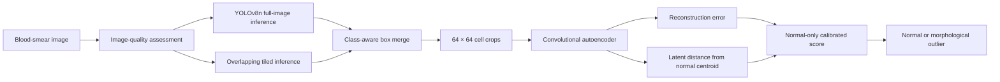

# BPD — Blood Platelet Detection

**BPD** is a local Windows research application for blood-smear cell localization and morphological outlier review. It detects red blood cells, white blood cells, and platelets, then compares each detected crop with a learned normal-cell baseline.

> BPD is a research prototype. Its morphological candidate flags are not a diagnosis and must be reviewed by a qualified professional.

## Install the Windows application

Download [`BPD-Setup-2.3.0.exe`](https://github.com/ritwik1612/BLOOD-PLATELET-DETECTION/releases/download/v2.3.0/BPD-Setup-2.3.0.exe) from the [latest release](https://github.com/ritwik1612/BLOOD-PLATELET-DETECTION/releases/latest).

The installer lets you choose the installation folder and adds **BPD** to Windows Search and the Start menu. The installed program opens in its own desktop window and performs inference locally. It does not require Python, open a browser, show a terminal, or listen on a localhost port.

## Desktop interface

- Black background with blood-red accents, local fonts, and a compact upload/results workflow.
- Muted green outlines for cells within the normal reference and red outlines for review candidates.
- A stock-style morphology-score chart with a dashed threshold line. Each point is one detected cell in detection order, not a time measurement.
- Click a red cell box to highlight its chart point and display its actual score and decision threshold.
- Filter the chart by RBC, WBC, or platelets, and switch between the original image and detection overlays.

The chart displays each cell's score divided by its existing decision threshold, making 1.0 the threshold marker. Display controls do not change the detector, model weights, score calculation, thresholds, or final decisions. Fonts are bundled for offline use; their licenses are included under `web_app/static/fonts`.

## Processing pipeline



The current runtime includes:

- YOLOv8n localization for WBC, RBC, and platelet candidates.
- Full-field inference combined with overlapping 640 px tiles for dense or high-resolution smears.
- Class-aware duplicate suppression across tile boundaries.
- A conditional 1024 px retry when stained fields yield too few candidates.
- Low-stain rescue for high-confidence detector candidates.
- Cell-foreground and RBC-cluster guards to reduce invalid anomaly crops.
- A convolutional autoencoder trained with normal cell crops.
- Anomaly scoring from normalized reconstruction error and cosine distance to the class centroid.
- A fixed normal-validation calibration plus a robust image-relative RBC guard.
- Focus, exposure, contrast, and resolution checks before inference.

DMC support remains implemented but disabled in the released configuration because it has not yet shown a reliable improvement on held-out data.

## Data and model boundary

The detector checkpoint is derived from the [TXL-PBC dataset](https://github.com/lugan113/TXL-PBC_Dataset). The anomaly model learns a normal reference from normal WBC, RBC, and platelet crops. Infected images are used for held-out evaluation rather than threshold fitting.

This repository contains the four runtime artifacts needed by the desktop application:

| Artifact | Purpose |
| --- | --- |
| `yolov8n_txl_pbc_best.pt` | YOLOv8n cell localizer |
| `autoencoder_best.pt` | Normal-cell reconstruction model |
| `centroids.pt` | Normal latent-space class centroids |
| `anomaly_calibration.json` | Normal-validation score ranges and threshold |

Training datasets, experiment workspaces, notebooks, and generated evaluation images are intentionally excluded.

## Run from source

Python 3.10 is recommended.

```powershell
git clone https://github.com/ritwik1612/BLOOD-PLATELET-DETECTION.git
cd BLOOD-PLATELET-DETECTION
py -3.10 -m venv .venv
.\.venv\Scripts\python.exe -m pip install --upgrade pip
.\.venv\Scripts\python.exe -m pip install -r requirements.txt
.\.venv\Scripts\python.exe desktop_launcher.py
```

The approved interactive interface runs through `desktop_launcher.py`. Its JavaScript-to-Python bridge reads the existing pipeline output directly; the legacy Flask API is retained unchanged.

## Build the Windows package

```powershell
.\.venv\Scripts\python.exe -m pip install pyinstaller
.\.venv\Scripts\python.exe installer\make_installer_assets.py
.\.venv\Scripts\python.exe -m PyInstaller --noconfirm --clean --distpath dist_desktop --workpath build_desktop BPD.spec
& "$env:LOCALAPPDATA\Programs\Inno Setup 6\ISCC.exe" installer\bpd.iss
```

The installer is written to `installer\release\BPD-Setup-2.3.0.exe`.

## Repository layout

```text
anomaly_detection/     Calibration and anomaly-score logic
configs/               Detector and anomaly runtime settings
feature_extraction/    Autoencoder loading and latent extraction
inference/             Detection, tiling, merge, and scoring pipeline
models/                YOLO and autoencoder definitions
outputs/weights/       Runtime model artifacts
utils/                 Image processing, quality, and visualization helpers
web_app/               Interface and local prediction endpoint
desktop_launcher.py    Native pywebview entry point
BPD.spec               PyInstaller build definition
installer/             Inno Setup definition and branded assets
```

## Result labels

| Label | Meaning |
| --- | --- |
| `WBC`, `RBC`, `PLAT` | Candidate consistent with the learned normal reference |
| `AWBC`, `ARBC`, `APLAT` | Morphological outlier candidate for review |

The original baseline is retained separately in the [`BPD-V1`](https://github.com/ritwik1612/BPD-V1) repository.
